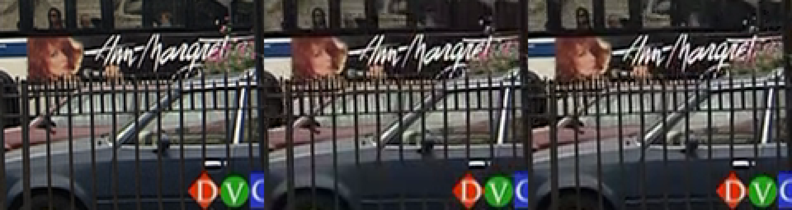

# Sinter Video Codec

An experimental, vibecoded video codec built from scratch using [Claude Code](https://claude.ai/code) agent teams. It started as an exploration of lapped transforms, perceptual vector quantization (PVQ), and rANS entropy coding as a patent-free alternative to the H.264/H.265 lineage.

**This was a learning experiment**, not a production codec. The goal was to test one-shot agent team workflows on a domain I had zero prior experience in — and to see how far a simulated expert team could push a novel architecture. Write-up: [One-Shot Wonder](https://dheer.co/one-shot-wonder/) | [Claude Agent Teams](https://dheer.co/claude-agent-teams/)

In October 2026 the codec was reworked with Claude Code: bugs fixed, compression tools added, and the format rebuilt so that every tool the decoder runs comes from a publication before 2004, or is new and was searched for in patents first (see [Where the tools come from](#where-the-tools-come-from)). A second round added motion-vector decisions by trial encoding, RD-optimized quantization, chroma coded like luma, three reference frames, OBMC, B-frame direct mode, a quintic B-spline and more contexts, under the same rule, which now covers the encoder's own methods too ([docs/EXPERIMENTS.md](docs/EXPERIMENTS.md)). Every change was measured against x264.

## Results

On real camera footage, Sinter now needs **about the same bitrate as H.264 (x264)** for the same luma quality: 0.96–1.09x. The original experiment needed 10.5–17.6x.

| Clip | Original experiment | October 2026, first round | Second round |
|------|---------------------|---------------------------|--------------|
| Foreman | 14.5x | 1.24x | **0.96x** |
| Mobile & Calendar | 10.5x | 1.28x | **0.98x** |
| Akiyo | 17.6x | 1.21x | **0.99x** |
| Bus (held out) | – | 1.32x | **1.09x** |
| News (held out) | – | 1.17x | **0.99x** |

Each figure is the bitrate Sinter needs to match x264's luma PSNR (BD-rate), on the Xiph CIF test sequences (352x288, first 150 frames); below 1x, Sinter needs fewer bits. x264 runs at `-preset medium -tune psnr` with a constant QP (which includes its adaptive B-frames, trellis quantization and 3 reference frames) and the same 30-frame keyframe interval. Bus and News were never used for tuning. Counting chroma (YUV PSNR) gives 0.97–1.12x; SSIM gives 0.95–1.09x. Against x264 in CRF mode, where its MB-tree look-ahead adapts the QP, Sinter needs 1.00–1.13x on luma.

The original write-up reported 18.6x from a two-point comparison on a synthetic 256x256 clip. [SCOREBOARD.md](SCOREBOARD.md) and [docs/TECHNICAL_REFERENCE.md](docs/TECHNICAL_REFERENCE.md) record that original design and have not been updated.

## Examples

Left to right: the source, Sinter (QP 20), and x264 at the same file size. Frame 44 (a B-frame), cropped and zoomed 3x. Here x264 uses its default tuning, 2-pass, at Sinter's bitrate; that tuning trades some PSNR for SSIM and looks. Each clip also has a side-by-side video of the full 5 seconds, in the same order.

**Foreman**: Sinter 218 kbps, 35.4 dB, SSIM 0.926; x264 218 kbps, 34.5 dB, SSIM 0.927.


[Watch the side-by-side video](docs/videos/foreman.mp4)

**Mobile & Calendar**: Sinter 667 kbps, 31.2 dB, SSIM 0.957; x264 666 kbps, 30.6 dB, SSIM 0.957.


[Watch the side-by-side video](docs/videos/mobile.mp4)

**Bus** (held out): Sinter 649 kbps, 32.2 dB, SSIM 0.923; x264 649 kbps, 32.4 dB, SSIM 0.946.



[Watch the side-by-side video](docs/videos/bus.mp4)

## What's in It

- **16x16 macroblocks**: in P- and B-frames, each is skipped, coded with one motion vector, or split into four 8x8 blocks with their own modes
- **Skipped blocks** repeat the motion of the block to their left (MPEG-1's rule) or follow a **global motion vector** sent per frame (MPEG-4 Part 2's GMC), which the encoder estimates by Lucas-Kanade
- **8x8 integer DCT** for luma, with AC coefficients in zigzag order grouped into 16 bands, each with a coded flag; **4x4** for chroma, each block with a coded flag (H.261's coded block pattern)
- **Intra prediction** of the DC and first coefficient row or column from the neighbours (H.263 Annex I)
- **Inter prediction**: quarter-pel motion compensation through a quintic B-spline of each reference frame (luma) and 1/8-pel bilinear (chroma), **overlapped** with the neighbours' motion (H.263 Annex F's OBMC), H.263's median vector prediction
- **Up to three references** for P-frames: the newest anchor, the one before it, and the GOP's key frame as a long-term reference (H.263 Annex U)
- **B-frames**: two between anchor frames by default, each block predicted forward, backward, from the average of both, or in **direct mode** with vectors scaled from the anchor's (MPEG-4 Part 2), in closed GOPs
- **Decisions by trial encoding**: each candidate (skip, inter at several candidate vectors, intra; 16x16 or 8x8) is coded without emitting it, chroma included, and the lowest distortion + lambda x bits wins; the best vector is then refined at quarter-pel steps. [docs/ENCODER.md](docs/ENCODER.md) describes these and the encoder's other decision methods, with their measured gains
- **RD-optimized quantization**: each level chosen by distortion + lambda x bits, then the bands coded or zeroed together by a Viterbi pass (Ramchandran & Vetterli 1994; Wen, Luttrell & Villasenor 2000)
- **QP by GOP position**: anchors with few frames after them in the GOP are coded coarser (dependent quantization, Ramchandran, Ortega & Vetterli 1994)
- **In-loop deblocking filter** (H.263 Annex J) on luma and chroma block edges
- **Range coder** with adaptive frequency counts, starting from tables trained on other Xiph clips; levels, DC levels and vector deltas are coded as binary decisions as in JPEG's arithmetic mode, with contexts from neighbouring blocks and coefficients (JBIG's templates; Tu & Tran 2002)
- **Three new context tools**: the residual's models are chosen from the DCT of its prediction, and the mode flags' and the vector deltas' models from how well two decoder-side predictions agree ([docs/NOVEL.md](docs/NOVEL.md))
- **CLI tools** with Y4M I/O (`sinterenc` / `sinterdec`); `sinterdec` reorders B-frames to display order
- **Evaluation harness** in [tools/eval](tools/eval): BD-rates against earlier commits or x264, bit breakdowns, stills
- 32 passing tests; encoder and decoder reconstructions match bit-exactly on every test clip
- About 250–600 ms to encode and 4–12 ms to decode a CIF frame on a laptop

The lapped transform, PVQ, rANS and the film grain synthesis of the original design are still in the tree, but none of them is part of the format: see [PROVENANCE.md](PROVENANCE.md).

## Quick Start

```bash
make && make test

# Build CLI
gcc -O2 -I libsinter tools/sinterenc.c -Lbuild -lsinter -lm -o build/sinterenc
gcc -O2 -I libsinter tools/sinterdec.c -Lbuild -lsinter -lm -o build/sinterdec

# Encode/decode
ffmpeg -f lavfi -i "testsrc=duration=1:size=64x64:rate=10" -pix_fmt yuv420p -f yuv4mpegpipe input.y4m -y
./build/sinterenc -i input.y4m -o encoded.sntr -q 12
./build/sinterdec -i encoded.sntr -o decoded.y4m
```

`sinterenc` takes `-k` for the keyframe interval (default 30) and `-b` for the number of B-frames between anchors (default 2). The bitstream has changed since the original experiment: `.sntr` files are now container version 5, and files from earlier versions do not decode.

## Where the tools come from

[PROVENANCE.md](PROVENANCE.md) lists every tool the decoder runs, with its source, date and the changes made to it. All but three come from publications between 1974 and 2002: the DCT (1974), Martin's range coder (1979), Witten, Neal & Cleary's adaptive models (1987), H.261 (1988), Unser's B-splines (1991), JPEG (1992), MPEG-1 and JBIG (1993), H.263 and its annexes (1996–2000), Orchard & Sullivan's OBMC (1994), MPEG-4 Part 2 (1999–2000), Wiegand, Zhang & Girod's long-term memory prediction (1999) and Tu & Tran's coefficient contexts (2002). Nothing comes from H.264 or later codecs (VP8 onward, Daala, AV1). The encoder's own methods (RD quantization, the vector and mode decisions, the QP by GOP position) also have pre-2004 sources or a recorded patent search: [docs/EXPERIMENTS.md](docs/EXPERIMENTS.md) gives them, with every experiment tried, kept or dropped.

The three new tools are described in [docs/NOVEL.md](docs/NOVEL.md), with the patent searches run before keeping them. Two other new ideas were left out because the searches found them: online logistic mixing of several probability models (Google, EP3677027 / US10887595), which was still built behind an off-by-default compile switch (`-DSNT_EXPERIMENT_MIXING`) and measured at 0.5%, and per-clip probability tables sent as changes from defaults (VP8's frame-header updates), also built behind a switch (`-DSNT_EXPERIMENT_CLIPTABLES`) and measured at 0.1%.

One more idea was built, measured and left out for patent risk: a QP per key-frame macroblock chosen by look-ahead (0.9% on luma, 3.5% on SSIM), close to active patents on look-ahead adaptive quantization ([docs/EXPERIMENTS.md](docs/EXPERIMENTS.md), item 13b).

These records are a map of where each idea comes from, not a patent clearance.

The entropy models' starting tables are trained on ten Xiph CIF clips that are never used for evaluation; [tools/train/README.md](tools/train/README.md) shows how to regenerate them.

## Where the Gap Came From

The original "why the gap exists" estimates were the expert team's guesses. Measured instead:

- With x264 limited to the original Sinter's toolset (no B-frames, one reference frame, full-pel motion, CAVLC, no deblocking), x264 needed 2.2–3.5x its normal bitrate. The original Sinter needed another 2.1–3.5x on top of that. So about half of the original gap was missing tools, and half was bugs and implementation.
- The largest single gains in October 2026 came from quarter-pel motion, B-frames, skipped blocks that follow the motion, and mode decisions by trial encoding; in the second round, from choosing motion vectors by trial encoding among several candidates (6%), chroma coded like luma (3.4%), multiple references (4.1%), OBMC (2%), direct mode, the quintic spline and RD quantization (1.5% each). The git history and [docs/EXPERIMENTS.md](docs/EXPERIMENTS.md) give every change with its measured effect.

What x264 still has that Sinter doesn't: adaptive B-frame placement, B-frames as references, more partition shapes (16x8, 8x16, 4x4) and transform sizes, weighted prediction, and look-ahead rate control and adaptive quantization (MB-tree, AQ).

## Known Issues

- The public C API (`sinter.h` / `sinter.c`) is not built by the Makefile, and `snt_decoder_decode` passes an uninitialized stride. It also has no B-frame support. The CLI tools use the internal API and are unaffected.
- The FFmpeg wrapper (`ffmpeg/`) and the WASM build (`wasm/`) depend on that API and are untested.
- The decoder is not hardened against malformed input: a damaged frame can decode to garbage, and a frame larger than the container header says can overflow the output buffer.
- Inter frames assume the luma stride equals the frame width, which is true for the CLI tools.
- Changing the entropy model set requires regenerating `libsinter/codec/model_tables.h` (a static assertion catches a mismatch in the number of models).

## Credits

Built with [Claude Code](https://claude.ai/code). The expert team was assembled by asking Claude to name five experts for building an open-source codec competing with H.264/H.265:

- **Jim Bankoski** — Google architect behind VP8 and VP9; open-codec veteran
- **Timothy Terriberry** — Mozilla/Xiph engineer; drove Daala and AV1 research
- **Monty Montgomery** — Xiph.org founder; built Ogg, Vorbis, and Theora ecosystems
- **Gary Sullivan** — Microsoft; co-chaired the H.264 and HEVC standardization efforts
- **Jens-Rainer Ohm** — HEVC co-chair; deep expertise in perceptual coding theory

Plus a principal engineer (facilitator) and patent reviewer. All personas simulated by Claude.

The October 2026 improvements were also done with Claude Code, without personas, much of it autonomously toward fixed targets: each change was measured by BD-rate against x264 on the Xiph clips and kept only if it helped, except replacements made for their sources. The git history records each change, its measured effect, and the changes tried and dropped.

## Requirements

- C11 compiler (GCC or Clang)
- make
- ffmpeg (for Y4M generation)
- No external dependencies (Python 3 only to retrain the entropy tables)
